  

  

  
  

I build interactive web projects with HTML, CSS, JavaScript, and Tailwind CSS. At YouCode in Morocco, I’m expanding my programming and database skills with C, Java, and SQL.

## Selected projects

<table>
  <tr>
    <td width="50%" valign="top">
      <h3><a href="https://github.com/Yassine-aboulayt/mythoria-collectible-cards">Mythoria · Collectible Cards</a></h3>
      
An interactive fantasy trading card website. Open booster packs, collect cards, and build your own decks.

      
<strong>HTML · Tailwind CSS · JavaScript</strong>

      
<a href="https://github.com/Yassine-aboulayt/mythoria-collectible-cards">View repository ↗</a> &nbsp; <a href="https://mythoria-collectible-cards-wbbj.vercel.app/">Live demo ↗</a>

    </td>
    <td width="50%" valign="top">
      <h3><a href="https://github.com/Yassine-aboulayt/Site-Web-De-Fitness">Élan Fitness</a></h3>
      
A multi-page fitness website with home, programmes, about, and contact pages. Built with HTML and CSS.

      
<strong>HTML · CSS</strong>

      
<a href="https://github.com/Yassine-aboulayt/Site-Web-De-Fitness">View repository ↗</a> &nbsp; <a href="https://yassine-aboulayt.github.io/Site-Web-De-Fitness/">Live demo ↗</a>

    </td>
  </tr>
</table>

## Toolkit

<table width="100%">
  <tr>
    <td width="20%"><strong>Web</strong></td>
    <td>
      
      
      
      
    </td>
  </tr>
  <tr>
    <td><strong>Programming</strong></td>
    <td>
      
      
      
    </td>
  </tr>
  <tr>
    <td><strong>Tools</strong></td>
    <td>
      
      
      
      
      
    </td>
  </tr>
</table>

## Activity

<picture>
  <source media="(prefers-color-scheme: dark)" srcset="assets/github-snake-dark.svg" />
  <source media="(prefers-color-scheme: light)" srcset="assets/github-snake.svg" />
  
</picture>

  

