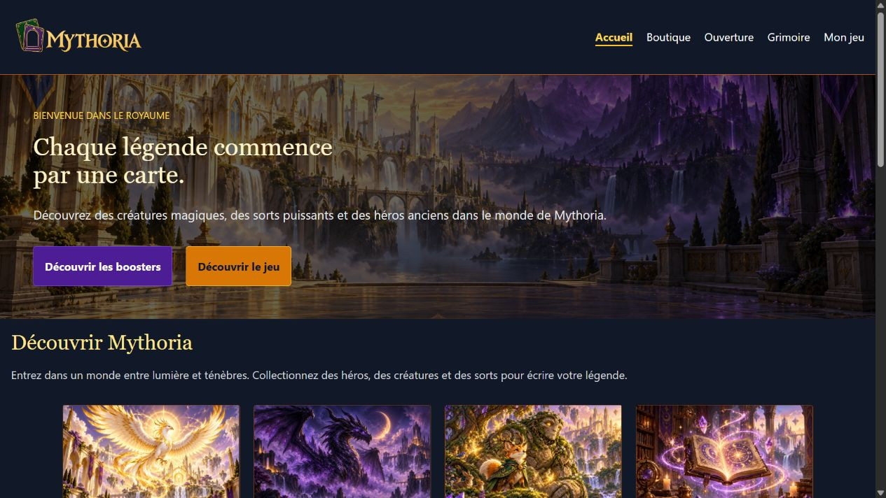
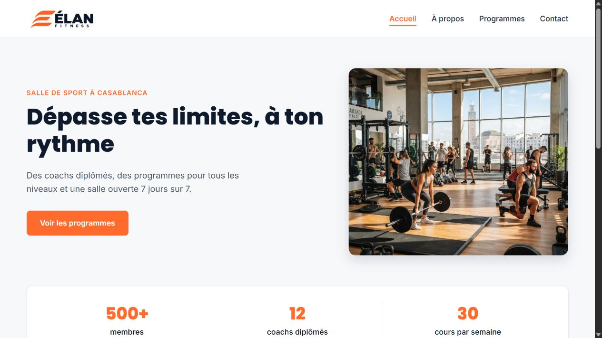
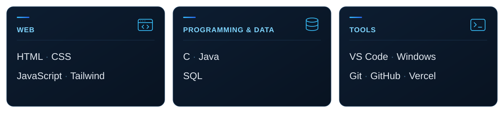

  <a href="#selected-work">Explore my work ↓</a> &nbsp; · &nbsp;
  <a href="https://www.linkedin.com/in/yassine-aboulayt-80b336439/">LinkedIn ↗</a> &nbsp; · &nbsp;
  <a href="mailto:yaboulayt01@icloud.com">Get in touch ↗</a>

I’m **Yassine**, a YouCode student in Morocco. I build expressive web interfaces with **HTML, CSS, JavaScript, and Tailwind CSS**, while developing my skills in **C, Java, and SQL**.

## Selected work

<table>
  <tr>
    <td width="50%" valign="top">
      
      
01 / FANTASY CARD EXPERIENCE

      <h3>Mythoria</h3>
      
<strong>Open packs. Collect cards. Build your deck.</strong>

      
Interactive booster openings, rarity filters, and a card collection saved with LocalStorage.

      
HTML · TAILWIND CSS · JAVASCRIPT

      
<a href="https://mythoria-collectible-cards-wbbj.vercel.app/"><strong>Live experience ↗</strong></a> &nbsp; <a href="https://github.com/Yassine-aboulayt/mythoria-collectible-cards">Source code ↗</a>

    </td>
    <td width="50%" valign="top">
      
      
02 / FITNESS BRAND WEBSITE

      <h3>Élan Fitness</h3>
      
<strong>Clear pages. One consistent brand.</strong>

      
A four-page website covering the home page, programmes, the brand, and contact information.

      
HTML · CSS

      
<a href="https://yassine-aboulayt.github.io/Site-Web-De-Fitness/"><strong>Live experience ↗</strong></a> &nbsp; <a href="https://github.com/Yassine-aboulayt/Site-Web-De-Fitness">Source code ↗</a>

    </td>
  </tr>
</table>

## My toolkit

## Behind the work

<picture>
  <source media="(prefers-color-scheme: dark)" srcset="assets/github-snake-dark.svg" />
  <source media="(prefers-color-scheme: light)" srcset="assets/github-snake.svg" />
  
</picture>

  

